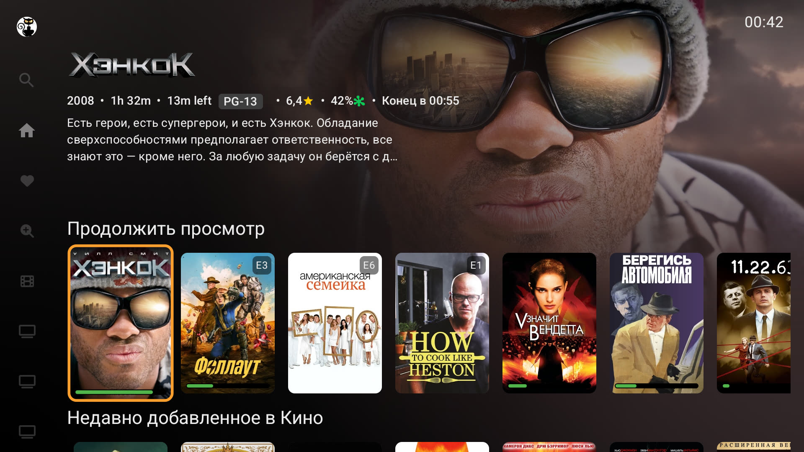
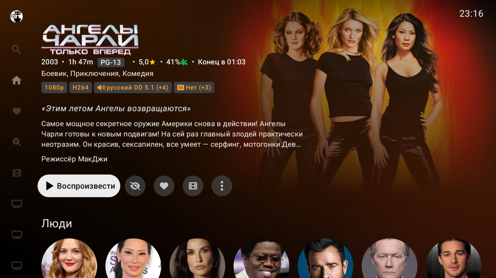
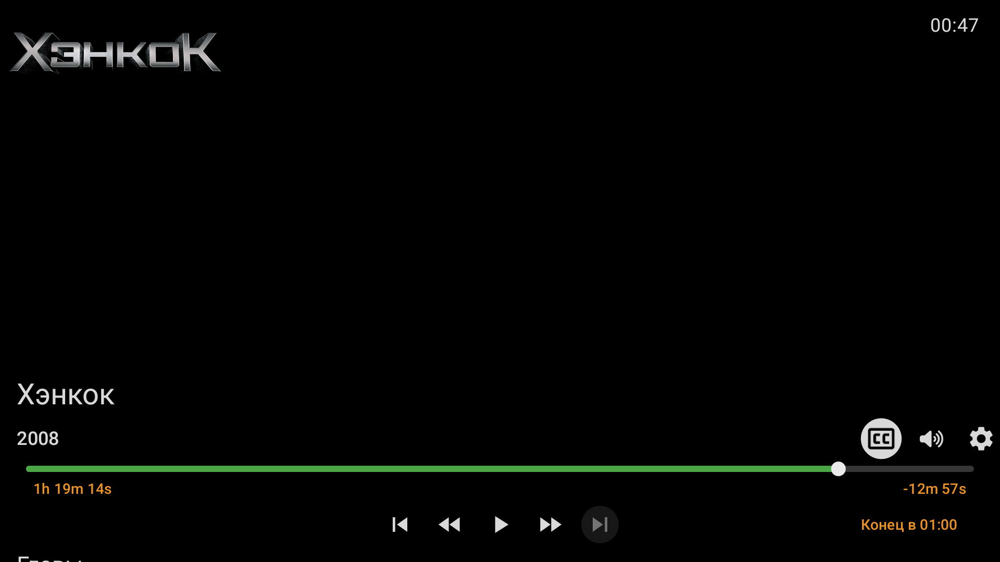
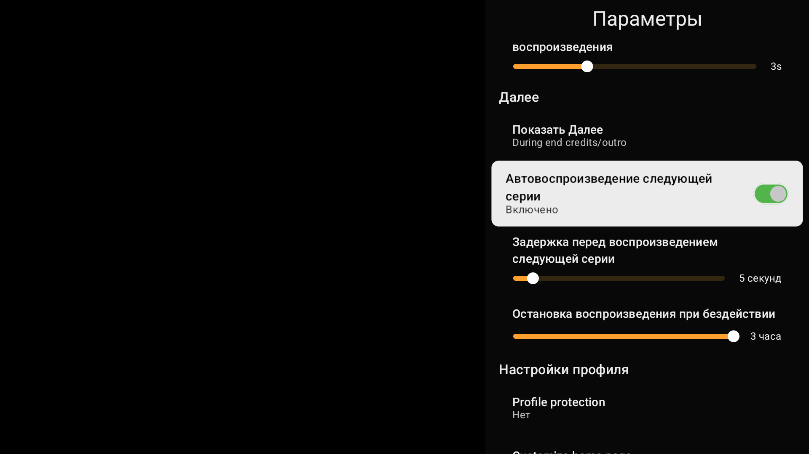
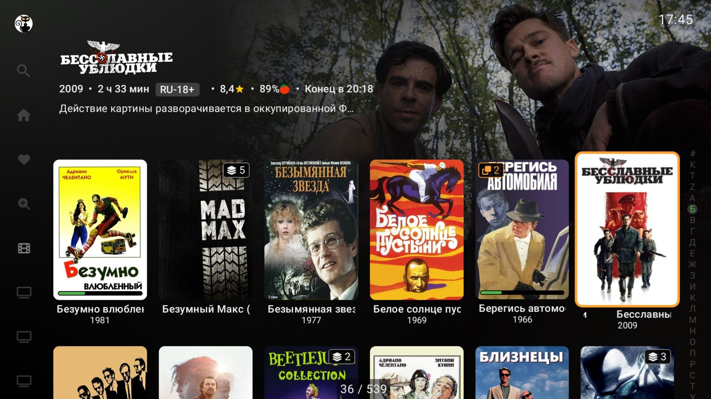
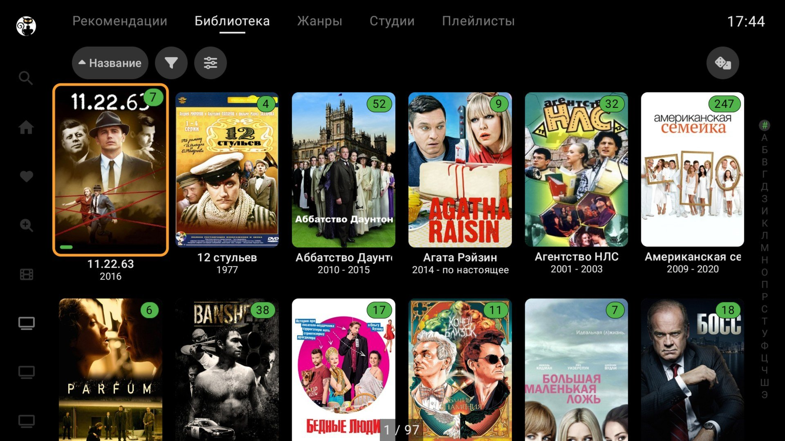
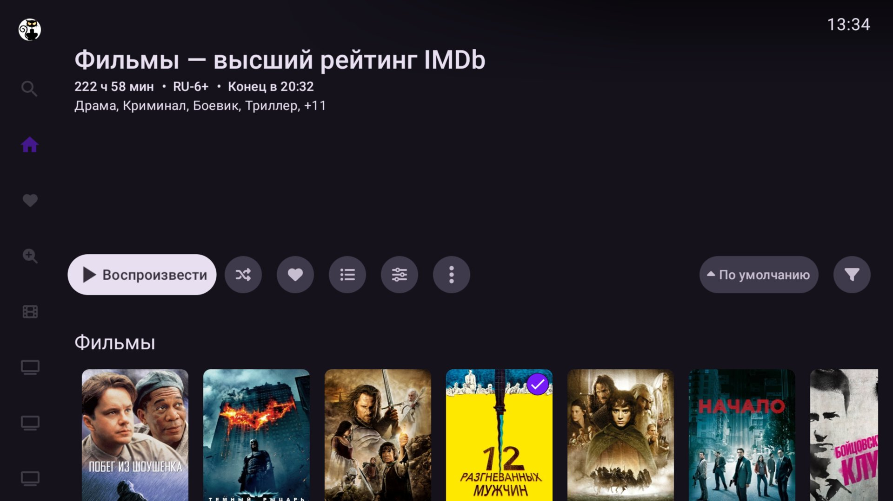
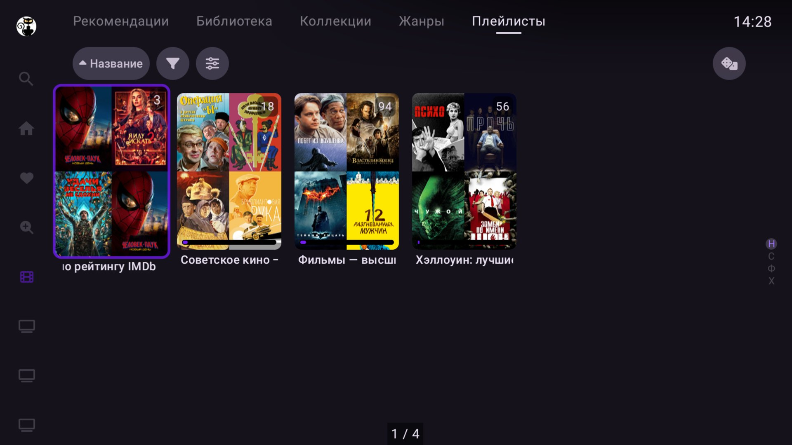

# Wholphin+ - a Wholphin fork for daily use

> "Never half-phin two jellies. Always wholphin one jelly."

**This is Wholphin+, a personal fork of [damontecres/Wholphin](https://github.com/damontecres/Wholphin)
kept in sync with upstream and used day-to-day.** It installs and updates independently of the
official app. Everything after the line below describes the shared upstream project; this part
lists **every difference from upstream**, with where each one stands upstream.

**Base:** upstream `main` as of 13 Oct 2026 (`v1.0.9` plus the commits merged since, including
[#1644](https://github.com/damontecres/Wholphin/pull/1644) "force enable or disable HDR / Dolby
Vision formats"), not only its last release.

## What is different from upstream

### Look and feel

- **Signal theme** — a new color theme: green for watched state and progress, orange for focus and
  technical labels. Proposed upstream in [issue #91](https://github.com/damontecres/Wholphin/issues/91)
- **Watched-progress bar on cards** — a thin, Plex-style fill over a dark track, colored like the
  watched badge, readable over light posters. Proposed upstream in
  [issue #1989](https://github.com/damontecres/Wholphin/issues/1989)
- **Card badges you can tell apart** — upstream draws every corner number as the same translucent
  black chip. Here each badge has its own look, in the current theme's colors:
  - *unwatched episodes* (series, seasons) — a pill in the "watched" check-mark color;
  - *number of versions* — an outlined "files" icon with the count in the accent color, also on
    home page rows, where upstream shows no version badge at all;
  - *collections* — a "stack" icon with the number of movies, plus the number left to watch once
    started and a check mark when fully watched (upstream's number here is the *unwatched* count
    with no hint what it means);
  - *episode number* — a neutral outlined chip; on the home page it includes the season ("S3 E2").

  Fork only for now
- **Details on two lines** — upstream puts year, runtime, time left, age, ratings and the end time
  on one line; on long lines (e.g. in Russian) the end time is cut down to a bare "Ends at", and in
  the library list panel the age and ratings vanish. Here the first line holds the year and
  everything about time, the second the age and ratings (only when there are any), and the end
  time is never split. In the Signal theme the year sits on a plate like the age rating, so both
  lines start with one. The library list panel drops year and runtime, already shown in the
  selected row, and gains the end time. Fork only for now

### Libraries and playlists

- **Alphabet jump bar shows only letters that have items** in the current library or filter. Sent
  upstream as [PR #1975](https://github.com/damontecres/Wholphin/pull/1975)
- **Video playlists open as a poster grid** — the collection screen with header, description, view
  options, sorting (including **Default**, the playlist's own order) and filters. A **Grid view /
  List view** button switches layouts, remembered per playlist; until you choose, video playlists
  open as a grid and music/mixed ones as a list
- **Remove from playlist** on long press in the grid, when you may edit the playlist (reordering
  stays in the list view)
- **Compact details header in the library grid** — with "Show details" on, upstream's header is a
  fixed 200 dp with the overview under the details, 400 dp wide; once the details take two lines the
  overview is cut to a sliver while the right half of the header stays empty. Here the overview sits
  on the right, level with the title, up to six lines; the left column takes what the title and
  details need, and a text title may wrap to two lines. The header is 150 dp, so the grid moves up.
  Fork only for now
- **Playlists tab in movie and TV libraries** — the playlists whose content belongs to that
  library, the same grouping the Jellyfin web client uses
- **Fixed: genre and parental-rating filters were empty in playlists** — the server returns no
  filter values for a playlist, so they are collected from its items; the list view gains a Genres
  filter too
- **Fixed: movies in a playlist were replaced by their collections** when the server option "Group
  movies into collections" is on (a 100-movie playlist showed 81 entries) — in the list, the grid
  and playback

  Playlist changes are fork only for now

### People

- **One person page, wherever you open it from** — upstream shows a full page (photo, biography,
  dates, library rows) for an actor opened from a library title, but a bare `Discover: <name>` grid
  for the same actor opened from a Seerr title. Here a Seerr person who is in the library opens the
  regular person page (matched by name and confirmed by TMDB id), and anyone else gets the same page
  filled from Seerr: photo, biography, birth and death dates, place of birth and the filmography row.
  Reported upstream in [issue #2022](https://github.com/damontecres/Wholphin/issues/2022)

### Playback

- **Player controls regrouped** — captions / audio / settings in one row next to the subtitle line
  above the seek bar; a d-pad-up press while the controls are hidden focuses the middle one, audio,
  instead of always landing on play/pause, so captions and settings are one press away
- **"Ends at" lined up and emphasized** — its right edge matches the remaining time above it, and
  it is bold so it reads apart from the two timecodes (same color)
- **Smaller trickplay preview** — 112 dp high instead of 160 dp (half the area): upstream's preview
  covers almost a third of a TV screen's height

### Dolby Vision (experimental settings, off by default)

- **Profile 7 → 8.1 conversion** — dual-layer Profile 7 rips direct play as Dolby Vision on devices
  whose decoder only lists Profile 8. Sent upstream as
  [PR #2017](https://github.com/damontecres/Wholphin/pull/2017)
- **Direct play for out-of-spec Dolby Vision** — files the server tags `DOVIInvalid` play directly
  instead of being transcoded, on devices with a Dolby Vision decoder. Sent upstream as
  [PR #2065](https://github.com/damontecres/Wholphin/pull/2065)

### Installation and updates

- **Installs side-by-side with the official app** — separate application ID, its own icon with an
  accent-colored plus badge so the launcher tells them apart
- **Updates from this fork's own [releases](https://github.com/SergeiAK/Wholphin-plus/releases)**,
  not from upstream or an app store; release APKs include the ffmpeg audio decoder (TrueHD, DTS)
- Version names follow the upstream release they are built on, e.g. `v1.0.9-30-g…`

 

 

 

No separate installation guide here: grab the latest APK for your device from
[this fork's releases page](https://github.com/SergeiAK/Wholphin-plus/releases/latest) the same
way the [Installation](#installation) section below describes for upstream, just pointed at this
repository instead. Issues and pull requests for the shared code belong upstream, at
[damontecres/Wholphin](https://github.com/damontecres/Wholphin) — this fork does not track its own
issue tracker.

---

Wholphin is an open-source Android TV client for Jellyfin. It aims to provide a different app UI that's inspired by Plex for users interested in migrating to Jellyfin.

This is not a fork of the [official client](https://github.com/jellyfin/jellyfin-androidtv). Wholphin's user interface and controls have been written completely from scratch. Wholphin supports playing media using either ExoPlayer or MPV.

 

## Features

### User interface

- Customize the home page to see the content you are interested in
    - Use poster or thumb images, show/hide titles, add/remove/re-order different types of rows!
    - Option to combine the Continue Watching & Next Up into a single row
    - Pin collections, playlists, favorites, genres, and studios
    - Remove series from next up
- A navigation drawer for quick access to libraries, favorites, search, and settings from almost anywhere in the app
- Integration with [Seerr](https://github.com/seerr-team/seerr) to discover new movies and TV shows
    - Note: only available when installed from [GitHub](https://github.com/damontecres/Wholphin/releases/latest) or the [Play store](https://play.google.com/store/apps/details?id=com.github.damontecres.wholphin)
- Customize library display
  - Option to show Movie/TV Show titles
  - Choose image types & size
  - Choose from grid or list layouts
- Play theme music, if available
- Customize subtitle style for plain text subtitles with separate HDR settings
- Search & download subtitles (requires compatible server plugin such as [OpenSubtitles](https://github.com/jellyfin/jellyfin-plugin-opensubtitles))
- Multiple app color themes
- Protect user profile switches with PIN code or require server login
- Change the user interface language per user
- In-app & Android OS screensaver support

### Playback

- Different media playback engines:
  - **ExoPlayer** w/ optional extra audio, SSA/ASS, & AV1 software decoding
  - **MPV** for direct playing anything with great SSA/ASS subtitle support
- Plex inspired playback controls:
  - Using D-Pad left/right for seeking during playback
  - Quickly access video chapters & queue during playback
  - Optionally skip back a few seconds when resuming playback
- Live TV & DVR support
- Music & music video support
- Cinema mode/pre-roll intro support (requires compatible server plugin such as [Intros](https://github.com/jellyfin/jellyfin-plugin-intros))
- Auto play next episodes with pass out protection
- Option for automatic refresh rate & resolution switching on supported displays
- Trickplay (video preview) support
- Subtly show playback position along the bottom of the screen while seeking w/ D-Pad

### Roadmap

See [here for the roadmap](https://github.com/damontecres/Wholphin/wiki#roadmap)

## Installation

Using [Google Play](https://play.google.com/store/apps/details?id=com.github.damontecres.wholphin) or [Amazon appstore](https://www.amazon.com/gp/product/B0G8RQQR9T/ref=mas_pm_wholphin) are the fastest way to install. But you can follow these instructions to install without needing an app store

Downloader Code: `8668671`

1. Enable side-loading "unknown" apps
    - https://androidtvnews.com/unknown-sources-chromecast-google-tv/
    - https://www.xda-developers.com/how-to-sideload-apps-android-tv/
    - https://developer.android.com/distribute/marketing-tools/alternative-distribution#unknown-sources
    - https://www.aftvnews.com/how-to-enable-apps-from-unknown-sources-on-an-amazon-fire-tv-or-fire-tv-stick/
2. Install the APK on your Android TV device with one of these options:
    - Install a browser program such as [Downloader](https://www.aftvnews.com/downloader/), use it to get the latest apk with short code `8668671` or URL: http://aftv.news/8668671
    - Download the latest APK release from the [releases page](https://github.com/damontecres/Wholphin/releases/latest) or http://aftv.news/8668671
        - Put the APK on an SD Card/USB stick/network share and use a file manager app from the Google Play Store / Amazon AppStore (e.g. `FX File Explorer`). Android's preinstalled file manager probably will not work!
        - Use `Send files to TV` from the Google Play Store on your phone & TV
        - (Expert) Use [ADB](https://developer.android.com/studio/command-line/adb) to install the APK from your computer ([guide](https://fossbytes.com/side-load-apps-android-tv/#h-how-to-sideload-apps-on-your-android-tv-using-adb))

### Upgrading the app

After the initial install above, the app will automatically check for updates. The updates can be installed in settings.

The first time you attempt an update, the OS should guide you through enabling the required additional permissions for the app to install updates.

Note: if installed via an app store, the app store will handle updates.

## Compatibility

Requires Android 6+ (or Fire TV OS 6+) and Jellyfin server `10.10.x` or `10.11.x` (tested on primarily `10.11`).

The app is tested on a variety of Android TV/Fire TV OS devices, but if you encounter issues, please file an issue!

Seerr integration is generally tested with the latest stable version. Older versions may not work as expected. The Seerr server should configured with integration to your Jellyfin server for full compatibility.

## Contributions

Issues and pull requests are always welcome! Please check before submitting that your issue or pull request is not a duplicate.

If you plan to contribute, please read the [contributing guide](CONTRIBUTING.md)!

You can [help translate Wholphin](https://translate.codeberg.org/engage/wholphin/)!

## Acknowledgements

- Thanks to the Jellyfin team for creating and maintaining such a great open-source media server
- Thanks to the official Jellyfin Android TV client developers, some code for creating the device direct play profile is adapted from there
- Thanks to the Jellyfin Kotlin SDK developers for making it easier to interact with the Jellyfin server API
- Thanks to numerous other libraries that make app development even possible

## Additional screenshots

### Customized home page

### Movie library browsing

### Movie page

### Series page

### Genres in library

### Playlist

